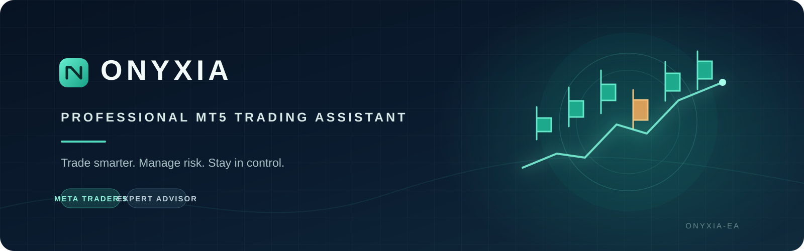
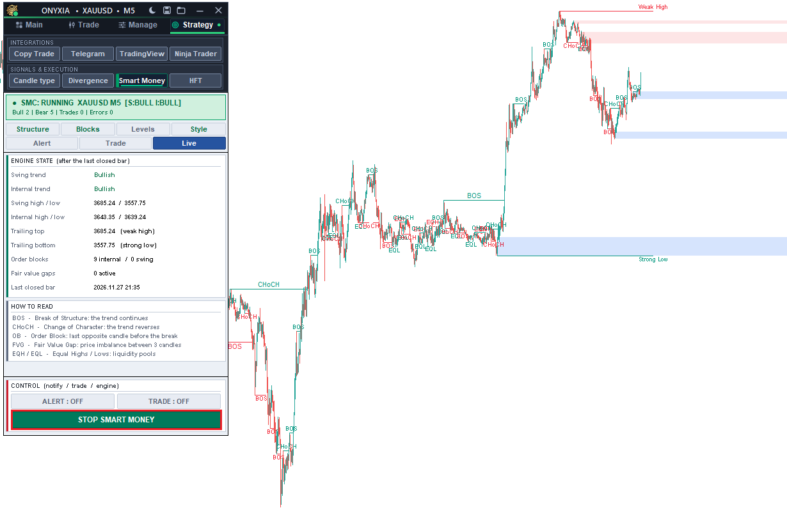
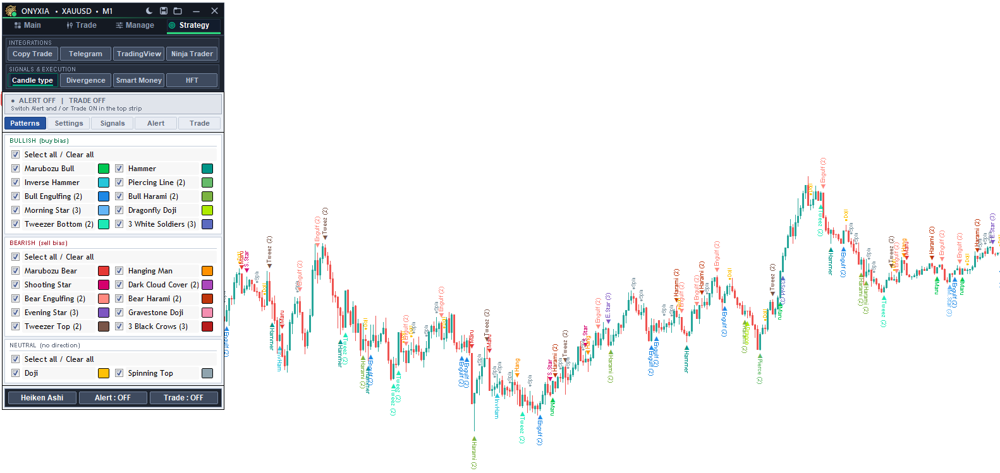
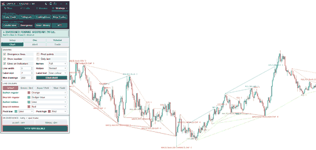
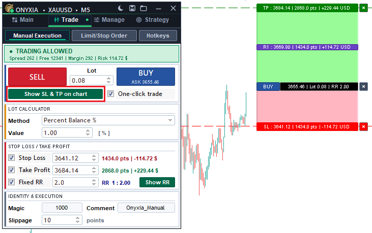
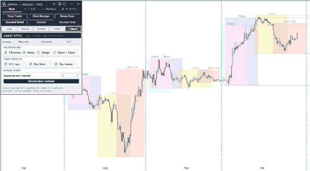
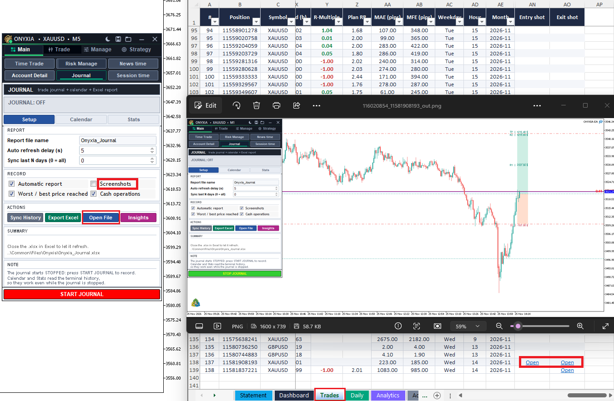

  

  <strong>A professional trading assistant for MetaTrader 5</strong> 
  Risk-aware trade management · On-chart tools · License and update support

  
  
  

  <a href="https://github.com/Onyxia-ea/onyxia-licenses/releases/latest"><strong>⬇ Download ONYXIA EA</strong></a>
  &nbsp;·&nbsp;
  <a href="docs/INSTALLATION.md">Installation Guide</a>
  &nbsp;·&nbsp;
  <a href="https://t.me/OnyxiaEA_Support">Support</a>

---

## About ONYXIA EA

**ONYXIA EA** is a MetaTrader 5 Expert Advisor designed to make trade execution and trade management more structured from the chart.

Its toolset is built around practical trading workflows, including:

- **On-chart trading panel** — access trading controls directly from the chart.
- **Risk and position sizing** — calculate trade volume using defined risk parameters.
- **Stop-loss and take-profit tools** — configure and manage trade protection levels.
- **Risk/reward utilities** — work with entry, stop-loss and target levels visually.
- **Trade management** — manage market and pending orders through the available panel tools.
- **License and update support** — receive license and update information through the ONYXIA service.

## Product Gallery

Every feature image below is a genuine screenshot of the ONYXIA EA interface running in MetaTrader 5. The gallery uses real product captures, not AI-generated mockups or reconstructed feature illustrations.

<table>
<tr>
<td width="50%" align="center">
 
<strong>Smart Money Structure</strong> Structure, blocks, levels and live market view
</td>
<td width="50%" align="center">
 
<strong>Candlestick Type</strong> Bullish, bearish and neutral pattern settings with chart markings
</td>
</tr>
<tr>
<td width="50%" align="center">
 
<strong>Divergence Analysis</strong> Divergence drawing, indicator selection and chart display
</td>
<td width="50%" align="center">
 
<strong>Manual Trading &amp; Risk/Reward</strong> Order controls, lot calculation, stop-loss and take-profit
</td>
</tr>
<tr>
<td width="50%" align="center">
 
<strong>Market Sessions</strong> Session-time display on the trading chart
</td>
<td width="50%" align="center">
 
<strong>Trading Journal &amp; Excel Export</strong> Trade-history journal and exported Excel report
</td>
</tr>
</table>

> ONYXIA is a trading and trade-management tool. It does not guarantee profits or eliminate market risk. Always understand the settings you use and test carefully before trading live.

## Download

The current public release is **ONYXIA EA v1.11**.

- [View all releases](https://github.com/Onyxia-ea/onyxia-licenses/releases)
- [Download v1.11 archive](https://github.com/Onyxia-ea/onyxia-licenses/releases/download/v1.11/ONYXIA.EA.V1.11.rar)
- [Read the installation guide](docs/INSTALLATION.md)

## Quick installation

1. Download the release archive from the link above.
2. Extract the <code>.rar</code> archive.
3. In MetaTrader 5, select **File → Open Data Folder**.
4. Copy <code>ONYXIA EA.ex5</code> into <code>MQL5/Experts</code>.
5. Return to MetaTrader 5 and refresh **Navigator**, or restart the terminal.
6. Attach **ONYXIA EA** to the chart and review its settings.

For first-time setup, license renewal and troubleshooting, follow the full [Installation Guide](docs/INSTALLATION.md).

## Required MetaTrader 5 settings

### 1. Allow WebRequest for the ONYXIA service

For automatic license renewal and update notifications:

1. Open **Tools → Options → Expert Advisors**.
2. Enable **Allow WebRequest for listed URL**.
3. Add this exact address to the allowed list:

   <code>https://raw.githubusercontent.com</code>

Without this permission, automatic license renewal and update notices may not work. See the installation guide for the manual license-file fallback.

### 2. Allow DLL imports (for About-window actions)

In the EA properties, open the **Common** tab and enable **Allow DLL imports** if you want to use the actions shown in the About window, such as Download / Update, Copy ID and support links.

Only enable this for the official ONYXIA EA package obtained from the official release page.

## License service

This repository also hosts signed, device-bound license files used by ONYXIA EA.

- License files are stored under <code>licenses/</code>.
- License files are generated by the ONYXIA licensing workflow.
- Do not edit, rename or manually replace files in <code>licenses/</code>.
- Do not modify <code>update.txt</code> or <code>.gitattributes</code>; the update and license delivery process depends on their exact contents and file handling.

**Protect your information:** never post your Device ID, license file, account details or private screenshots in a public GitHub issue or comment. Use an official ONYXIA support channel instead.

## Support and official channels

| Channel | Link |
|---|---|
| Telegram channel | [@onyxia_ea](https://t.me/onyxia_ea) |
| Customer support | [@OnyxiaEA_Support](https://t.me/OnyxiaEA_Support) |
| License bot | [@OnyxiaEA_Bot](https://t.me/OnyxiaEA_Bot) |
| Email | [onyxiaea@gmail.com](mailto:onyxiaea@gmail.com) |
| Instagram | [@onyxia_ea](https://www.instagram.com/onyxia_ea) |

## فارسی | معرفی اونیکسیا

**اونیکسیا (ONYXIA EA)** یک اکسپرت و دستیار معاملاتی برای MetaTrader 5 است که ابزارهای اجرای معامله، مدیریت پوزیشن و کنترل ریسک را در محیط چارت در اختیار معامله‌گر قرار می‌دهد.

### امکانات اصلی

- پنل معاملاتی روی چارت برای دسترسی سریع به ابزارهای معامله
- محاسبه حجم معامله بر اساس پارامترهای ریسک
- ابزارهای مدیریت حد ضرر و حد سود
- ابزارهای بصری ورود، حد ضرر، حد سود و ریسک به ریوارد
- مدیریت سفارش‌های بازار و سفارش‌های در انتظار، بر اساس امکانات نسخه
- پشتیبانی از سرویس لایسنس و اعلان به‌روزرسانی

### دانلود

**[دانلود آخرین نسخه ONYXIA EA](https://github.com/Onyxia-ea/onyxia-licenses/releases/latest)**

نسخه عمومی فعلی: **v1.11**

[مشاهده تمام نسخه‌ها](https://github.com/Onyxia-ea/onyxia-licenses/releases) · [راهنمای نصب فارسی و انگلیسی](docs/INSTALLATION.md)

### راهنمای سریع نصب

1. فایل فشرده RAR نسخه موردنظر را دانلود و استخراج کنید.
2. در متاتریدر ۵ از مسیر **File → Open Data Folder** وارد پوشه اطلاعات شوید.
3. فایل <code>ONYXIA EA.ex5</code> را در مسیر <code>MQL5/Experts</code> کپی کنید.
4. در متاتریدر، بخش Navigator را Refresh کنید یا ترمینال را دوباره اجرا کنید.
5. اکسپرت را روی چارت قرار دهید و تنظیمات آن را بررسی کنید.

### تنظیمات ضروری برای لایسنس و اعلان آپدیت

برای تمدید خودکار لایسنس و دریافت اعلان آپدیت، در مسیر **Tools → Options → Expert Advisors** گزینه **Allow WebRequest for listed URL** را فعال و آدرس زیر را اضافه کنید:

<code>https://raw.githubusercontent.com</code>

برای استفاده از برخی دکمه‌های پنجره About نیز در تب **Common** تنظیمات اکسپرت، گزینه **Allow DLL imports** را فعال کنید. این دو گزینه کاربرد متفاوتی دارند.

### پشتیبانی

- کانال تلگرام: [@onyxia_ea](https://t.me/onyxia_ea)
- پشتیبانی: [@OnyxiaEA_Support](https://t.me/OnyxiaEA_Support)
- ربات لایسنس: [@OnyxiaEA_Bot](https://t.me/OnyxiaEA_Bot)
- ایمیل: [onyxiaea@gmail.com](mailto:onyxiaea@gmail.com)
- اینستاگرام: [@onyxia_ea](https://www.instagram.com/onyxia_ea)

---

  © ONYXIA EA · Professional tools for MetaTrader 5

